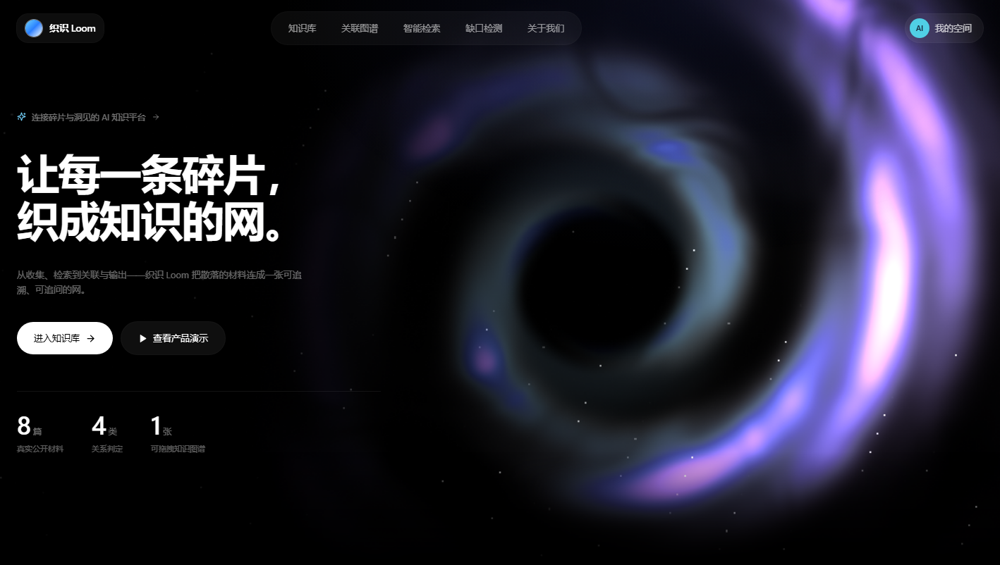
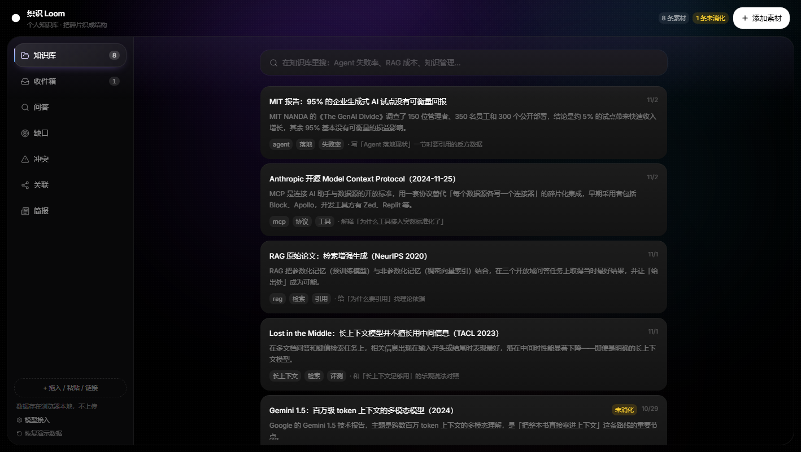
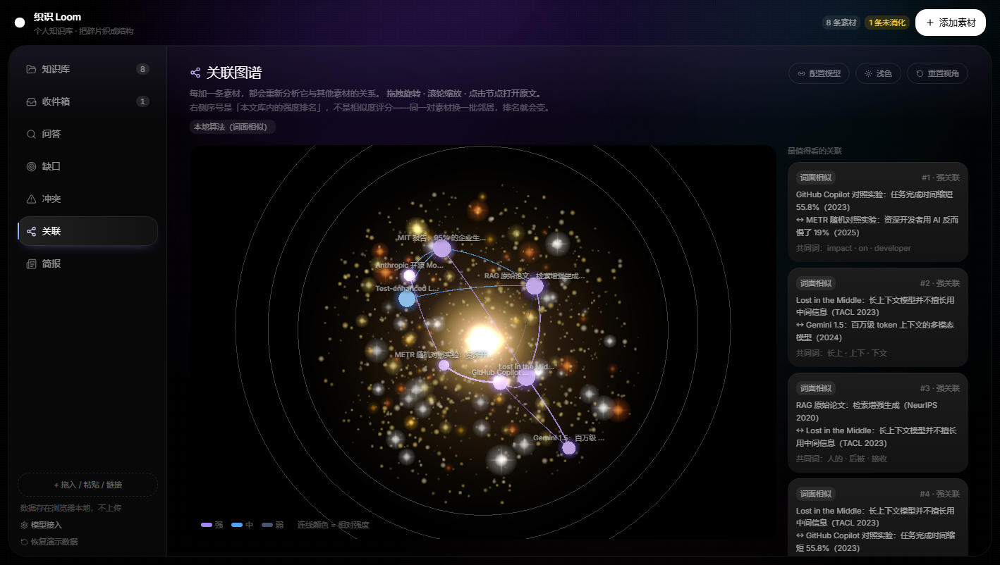

# 织识 Loom · 个人知识库助手

> 把碎片织成结构：带引用的检索、可追问的关联图谱、写到一半会告诉你缺什么的缺口检测。

一个面向真实资料库的 AI 知识助手。核心主张：**知识管理的价值不在「存」，而在「连接」和「输出」**。

---

## 快速开始

```bash
pnpm install
pnpm dev            # http://localhost:3000
```

**不需要任何 API Key 也能完整使用**：检索、缺口检测、简报、图谱全部在本地运行。
想要「云端建联」（模型判定支持/矛盾/重复并给理由），去 `/kb/settings` 填一个 Key。

```bash
pnpm verify   # 工程健康度 8 项 + 类型检查 + 单元测试
pnpm build
```

---

## 三个页面

| 路由 | 作用 |
|---|---|
| `/` | 落地页：品牌主张 + 黑洞星云主视觉（three.js 着色器实时绘制） |
| `/kb` | 作品主体：知识库 / 收件箱 / 问答 / 缺口 / 关联图谱 / 简报 |
| `/kb/settings` | 模型接入：填任意 OpenAI 兼容端点，可测试连接 |





---

## 核心能力

| 能力 | 说明 |
|---|---|
| **入库** | 粘贴 / `.md`·`.txt` / **PDF（服务端抽取，兼容区汉字自动归一）** / 链接抓取 / 截图与论文页（视觉模型转录） |
| **意图门** | 入库必须写「为什么存它」，留空进「收件箱」等补 |
| **检索问答** | 短语切分 + IDF + 词根回退；回答**强制带引用**；可再交模型生成综述 |
| **缺口检测** | 写下一句写作目标 → 逐条查证据覆盖度 → 「有支撑 / 偏薄 / 空白」+ 结论 |
| **关联图谱** | 3D 力导向图；本地算法或**云端模型**建联，点一条关系只亮这一对 |
| **冲突处理** | 模型判出「矛盾」后进入待办；**必须写下判断**才能关闭，未处理则简报锁定 |
| **简报** | 今日新增、待消化、7 天未打开、单一来源主题；总结可**由云端模型生成** |

### 冲突为什么必须处理


这不是「提示一下」：只要还有未处理冲突，**简报整页锁定**——因为同时引用两条互相矛盾的素材，写出来的总结一定是错的。

---

## 两条建联路径

| | 本地算法 | 云端模型 |
|---|---|---|
| 判据 | IDF 加权余弦相似度 + 标签加成 | LLM 语义判断 |
| 输出 | 强度等级（强/中/弱） | **关系类型**（支持 / 矛盾 / 重复 / 相关）+ 一句理由 |
| 成本 | 0 | 约 ¥0.01 / 次（24 条素材） |
| 触发 | 默认 | `/kb/settings` 配 Key 后点「云端重算」 |
| 降级 | — | 调用失败自动回退本地，图不清空 |

> 百分数是**本文库内的强度排名**，不是相似度评分——同一对素材换一批邻居，排名就会变。

> 预置的 8 条素材全部是**真实公开材料**（Fortune / Anthropic / arXiv / APS），标题、日期、链接均可核对；正文为中文整理稿，引用以原文为准。
> 其中 **s7（Copilot 提效 55.8%）与 s8（METR 实测慢 19%）是刻意选的一对矛盾证据**，用于演示冲突检测。

---

## 技术栈

| 层 | 选型 |
|---|---|
| 框架 | Next.js 15 App Router + TypeScript strict |
| 样式 | Tailwind v4（Aurora 色阶，颜色统一走 `--kb-*` 变量） |
| 状态 | Zustand 单 store |
| 3D | three.js（**按需加载**，不进首屏）+ 自定义片元着色器 / 点精灵着色器 |
| 模型 | 任意 OpenAI 兼容端点（默认 DeepSeek）；视觉模型单独配置（GLM-4V / qwen-vl） |

### 几个关键决定

1. **知识图谱用 three.js，落地页主视觉用片元着色器**，两者都通过 `dynamic(ssr: false)` 隔离，`/kb` 首屏仍只有 126KB。
2. **颜色只有一个来源**：`app/kb/kb.css` 的 `--kb-*` 变量，组件里禁止写裸 hex（`pnpm audit:ui` 强制）。
3. **云端失败不阻塞**：关系分析失败回退本地算法并提示原因，而不是白屏。

---

## 目录结构

```
app/
  page.tsx                 落地页（Server Component）
  kb/page.tsx              知识库主体
  kb/settings/page.tsx     模型接入
  api/ingest               链接抓取
  api/relations            云端建联
  api/llm/test             连接测试
components/
  landing/                 星云画布 + 客户端挂载点
  kb/                      知识库全部视图与组件
lib/
  kb/graph.ts              建图与 3D 布局（含单元测试）
  kb/text.ts               分词 / 排序 / 摘要
  kb/gaps.ts               缺口检测
  kb/relations.ts          云端建联客户端
  kb/store.ts              Zustand 状态机
docs/                      架构、设计系统、约定、路线图、产品规格
```

---

## 工程自检

```bash
pnpm verify
```

```
工程健康度  8/8 项通过
  ✓ 裸字号 0 处        ✓ 裸 hex 色值 0 处
  ✓ any/ts-ignore 0 处  ✓ 组件直连 store 0 个文件
  ✓ 卡片配方集中        ✓ console.log 0 处
  ✓ 测试文件 4 个
```

---

## 文档

| 文档 | 内容 |
|---|---|
| [ARCHITECTURE.md](docs/ARCHITECTURE.md) | 分层、状态边界、两条建联路径、降级策略 |
| [DESIGN-SYSTEM.md](docs/DESIGN-SYSTEM.md) | Aurora 色阶、字号、组件规范、无障碍 |
| [CONVENTIONS.md](docs/CONVENTIONS.md) | 目录归属、命名、复用、Git、DoD |
| [ROADMAP.md](docs/ROADMAP.md) | 阶段计划与验收物 |
| [PRODUCT-SPEC.md](docs/PRODUCT-SPEC.md) | 产品定位、功能清单、演示脚本 |
| [ENGINEERING-STANDARDS.md](docs/ENGINEERING-STANDARDS.md) | 八维审计快照与待办 |
| [REFERENCES.md](docs/REFERENCES.md) | 可借鉴的开源项目与合规红线 |
| [DEPLOY.md](docs/DEPLOY.md) | 部署步骤、环境变量、上线回归清单 |
| [TECH-REPORT.md](docs/TECH-REPORT.md) | 技术报告（问题、取舍、架构、实现、评测） |
| [VIDEO-SCRIPT.md](docs/VIDEO-SCRIPT.md) | 演示视频分镜脚本（逐字口播 + 操作顺序） |
| [DEMO-SCRIPT.md](docs/DEMO-SCRIPT.md) | 现场演示稿 + 可能被问到的问题 |

### 常用命令

| 命令 | 作用 |
|---|---|
| `pnpm dev` | 开发模式 |
| `pnpm demo` | 构建后启动演示实例 |
| `pnpm verify` | 设计规则 + 类型 + 单元测试 |
| `pnpm test:e2e` | 浏览器冒烟测试（需先启动服务） |
| `pnpm eval:relations` | 关系判定质量评测（20 条素材） |
| `pnpm eval:qa` | 问答质量抽测 |
| `pnpm eval:perf` | 首屏性能测量（4G + 降速） |
| `pnpm build:pdf` | 把技术报告渲染成 PDF |
| `pnpm verify:full` | 以上全部 |

---

## 部署

单实例 Next 应用，无需数据库（数据在浏览器 localStorage）。把 Key 放在**服务端环境变量**里，浏览器永远拿不到。

```bash
# .env.local（或平台的环境变量配置）
DEEPSEEK_API_KEY=sk-...
DEEPSEEK_BASE_URL=https://api.deepseek.com/v1
DEEPSEEK_MODEL=deepseek-chat

# 视觉模型（图片入库，可选）
VISION_API_KEY=sk-...
VISION_BASE_URL=https://open.bigmodel.cn/api/paas/v4
VISION_MODEL=glm-4v-flash

# 演示额度（防止共享 Key 被刷）
DEMO_QUOTA_PER_IP=20
DEMO_QUOTA_GLOBAL=300
```

规则：

1. **用户自己的 Key 优先**：在 `/kb/settings` 填了 Key 就用他的，不限流
2. **没有才用服务端 Key**：按 IP 每天 20 次 + 全局每天 300 次，超了提示「填自己的 Key」
3. 任何失败都回退本地算法，页面不会失去已有能力

按 100 位评审每人点 3 次估算，整个评审期成本约 **¥3**。
