# 织识 Loom · 作品介绍文档

> 个人知识库助手 —— AI 负责让你看清，不负责替你想清楚
> 在线演示：http://8.163.104.134
> 代码仓库：https://github.com/Andre-lingfeng/loom

---

## 一、项目详情及使用方式

### 1.1 这是什么

织识 Loom 是一个**会逼你输出的个人知识库**。

市面上的工具解决「存」：剪藏、收藏、稍后读。但存完之后的学习过程没人管。这个作品只解决后面那段——**存进来的东西，有没有变成你自己的判断**。

### 1.2 三个可观察的失败模式

| 失败模式 | 表现 | 现有工具的对策 |
|---|---|---|
| **存了不看** | 收藏夹里几百条，一条没重读过 | 无，甚至用「一键剪藏」加速囤积 |
| **看了不写** | 读完觉得懂了，合上就忘 | 无 |
| **写了不判断** | 素材互相矛盾，笔记却拼成自洽的结论 | 无 |

第三条最危险：模型会把两条冲突的材料缝成一段流畅但错误的总结，而用户不会察觉。

### 1.3 产品的三个硬规矩

1. **存素材必须写一句「为什么存它」**——写不出来就进不了库，只能待在收件箱
2. **写作前先查缺口**——告诉你哪些论点没有证据，而不是给个分数
3. **素材矛盾时必须由你判断**——模型只指出矛盾，不替你决定

### 1.4 八个视图

| 视图 | 作用 |
|---|---|
| 知识库 | 全部素材，可搜索、按标签筛选 |
| 收件箱 | 没写理由的素材挂在这里，一直提醒 |
| 问答 | 先给带出处的原文片段，需要时再让模型综述 |
| 缺口 | 输入写作目标，算出证据覆盖度与缺失方向 |
| 冲突 | 模型判出的矛盾，必须写判断才能关闭 |
| 文件夹 | 被取代的反方证据归档在这里 |
| 关联 | 3D 图谱，本地算法或云端模型判定关系 |
| 简报 | 今日新增、待消化、长期未打开、单一来源主题 |

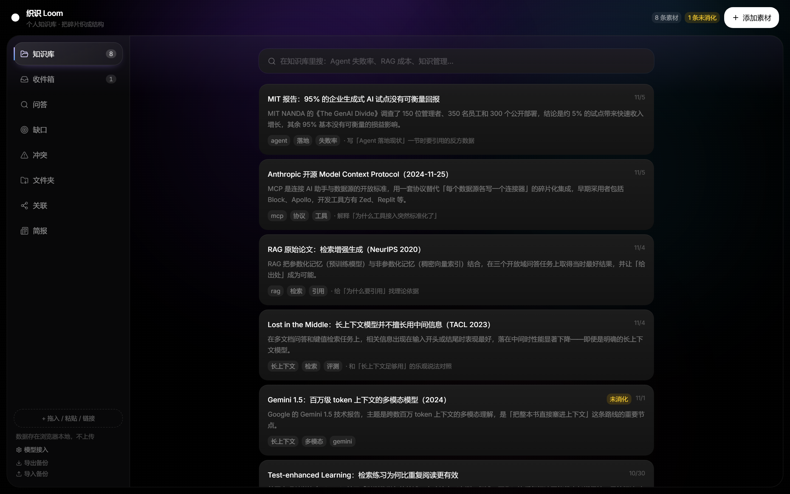

<p align="center"><sub>图 1　知识库主视图</sub></p>

### 1.5 怎么用（三条路径）

**路径 A：直接用线上演示（推荐）**

打开 http://8.163.104.134 ，无需注册、无需配置 Key。服务端已配置共享模型，按 IP 限流。

**路径 B：本地运行**

```bash
pnpm install
pnpm dev          # http://localhost:3000
pnpm demo         # 或：构建后启动生产实例
```

**路径 C：自己配模型**

`/kb/settings` 填任意 OpenAI 兼容端点（DeepSeek / 智谱 / 通义 / 自定义）。Key 只存浏览器，不上传。

### 1.6 一次完整的使用流程

```
① 添加素材（粘贴 / 文件 / PDF / 图片 / 链接）
② 写一句「为什么存它」→ 消化进库
③ 写东西前 → 查缺口 → 发现哪块没证据
④ 让模型找几篇能补上的材料 → 你决定加不加
⑤ 关联页云端重算 → 发现两条素材互相矛盾
⑥ 冲突页 → 让模型说清分歧 → 你做出判断
⑦ 简报 → 今天新增了什么、还有什么没消化
```

---

## 二、项目亮点

### 2.1 冲突必须由用户判断（核心差异）

模型只输出「这两条矛盾，争的是 X」，**不给结论**。用户必须选一边或选「都保留」，并写一句判断。

只要还有未处理冲突，**简报整页锁定**——因为同时引用两条互相矛盾的素材，写出来的总结一定是错的。

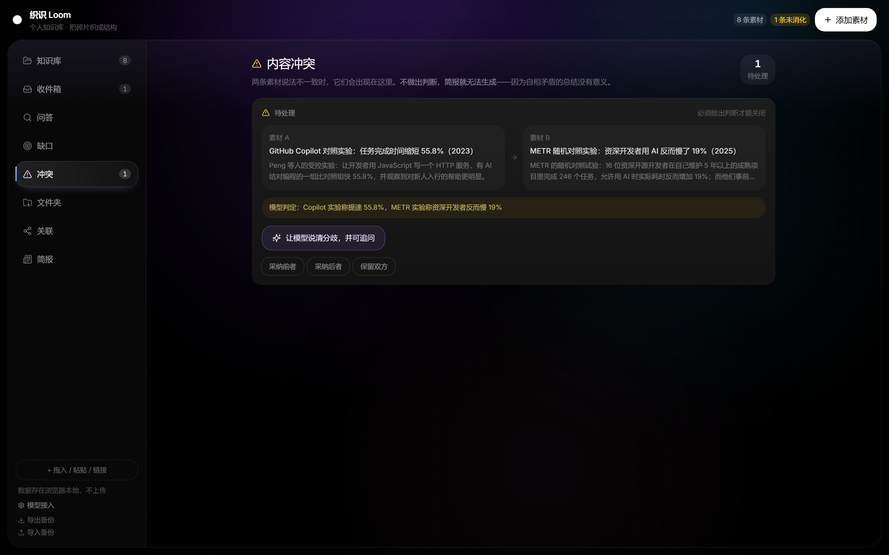

<p align="center"><sub>图 2　冲突页：必须给出判断才能收口</sub></p>

**反方证据不删除，进「文件夹」归档**，详情页可交叉跳转到对方。这是一个可逆操作：改判时先清除双方的取代关系，再应用新选择。

### 2.2 回答问题分两段，不缝合

```
【库中依据】  只用你的素材，每句带 [1][2]
【库外补充】  模型自身知识，单独成块标注「不在你的素材里」
```

拒绝回答会毁掉可用性；混在一起会毁掉可信度。分区是唯一同时保住两者的做法。

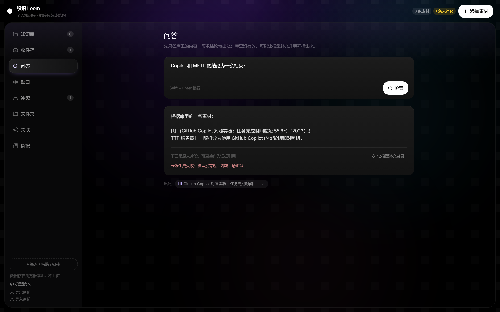

<p align="center"><sub>图 3　问答的两段式输出</sub></p>

### 2.3 从「发现缺口」到「补上」

光指出缺口不够。问答里出现「库外补充」时，下面会给出下一步：**让模型推荐几篇真实材料，用户决定加不加**。

- 提示词要求「不确定就留空 url」，不许编造链接
- 每条有独立的「抓取正文并加入知识库」，推荐 ≠ 入库
- 抓取失败直接报错，不假装成功
- 入库时自动写入收藏理由，仍然符合「存进来就要有理由」

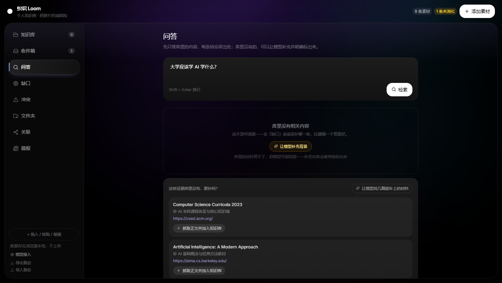

<p align="center"><sub>图 4　补材料：推荐真实材料，你决定是否入库</sub></p>

### 2.4 云端全部可降级

没有 Key、断网时，检索、缺口、简报、图谱（本地算法）全部可用。只有语义判定与图片识别降级。

很多 AI 作品断网即白屏；这个作品的核心价值不完全依赖外部服务。

### 2.5 数据只存在浏览器

素材、冲突、关系、模型配置全部在 localStorage，**不上传、不需要账号**，也就不存在「托管用户数据」的安全责任。

代价是换设备不迁移，因此提供了 JSON 导出/导入备份。

### 2.6 出错可诊断

错误条带「复制」，一键拿到时间、页面、接口、状态码、浏览器，粘贴即可定位。

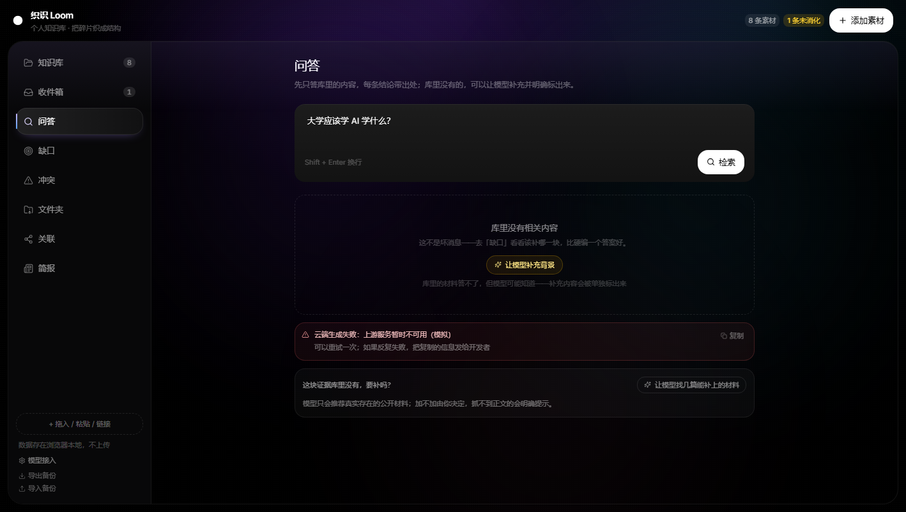

<p align="center"><sub>图 5　错误提示：一句话说清 + 可复制的诊断信息</sub></p>

---

## 三、AI 技术落地使用情况概述

### 3.1 AI 用在哪六处

| 环节 | 模型职责 | 没有模型时 |
|---|---|---|
| 关系判定 | 判断两条素材是支持 / 矛盾 / 重复 / 相关，并给一句理由 | 词面相似度（本地） |
| 冲突分析 | 说清分歧的实质，支持多轮追问 | 只显示「两条说法不一致」 |
| 问答综述 | 把检索到的片段组织成答案，分「库中/库外」两段 | 直接给原文片段 |
| 图片转录 | 把截图/白板/论文页转成正文 | 不可用 |
| 意图建议 | 读材料，给三个可能的收藏理由 | 手写 |
| 材料推荐 | 推荐能补上缺口的真实公开材料 | 不可用 |

### 3.2 关键设计：模型不替用户做决定

- 冲突：模型只标出，**判断权在用户**
- 问答：库内结论必须带引用编号，库外内容单独成块
- 材料推荐：只推荐，是否入库由用户点

### 3.3 实测数据

**关系判定**（20 条人工标注素材，连续 4 轮，线上环境）

| 指标 | 结果 |
|---|---|
| 已知矛盾检出 | **2 / 2（100%）** |
| 重复材料检出 | **1 / 1** |
| 矛盾误报 | 0.3 条/轮 |
| 无关素材误连 | 4.0 条/轮 |
| 平均关系数 | 13.0 条 |
| 平均耗时 | **12.3 秒** |
| 平均 token | **3,302**（约 ¥0.004/次） |

**结论**：高价值信号（矛盾）可靠；低价值信号（泛相关）判得偏松，需要用户自己筛。

**问答质量**（4 个用例，覆盖库内可答、库内不可答、跨材料综合）

| 指标 | 结果 |
|---|---|
| 引用标注率 | 4 / 4 |
| 两段结构合规率 | 4 / 4 |
| 编造数据 | **0 例** |
| 平均耗时 | **3.3 秒**（2.6–4.4s） |
| 平均 token | **668** |

最有说服力的一例：问「Transformer 自注意力的计算复杂度」，模型先说「这两条素材都是 AI 编程工具实验，无法回答」，再把复杂度知识放进库外补充。

**过程中修掉的真实问题**：初版 `max_tokens = 2200`，20 条素材时有 1/3 请求被截断；提到 4096 后 4/4 成功。这类问题单测和 E2E 都抓不到，只有真实规模的压力测试才暴露。

### 3.4 工程验证

| 项 | 方法 | 结果 |
|---|---|---|
| 设计规则 | `pnpm audit:ui`（8 条） | 8/8 |
| 单元测试 | `node --test` | 6/6 |
| 端到端 | `pnpm test:e2e`（真实 Chrome，跑线上地址） | 4/4 |
| 视觉识别 | 296KB 界面截图 | 完整读出结构与文字 |
| PDF 解析 | 7.2MB / 300 页 | 127 万字，零上传 |

评测脚本已入库（`evals/`），改完提示词可重跑同一批素材做对比。

---

## 四、关键技术

### 4.1 技术栈

| 层 | 选型 |
|---|---|
| 框架 | Next.js 15（App Router）+ React 19 |
| 语言 | TypeScript（strict，`any` 零容忍） |
| 样式 | Tailwind v4（CSS-first）+ 设计令牌 |
| 状态 | Zustand（localStorage 持久化） |
| 3D | three.js（自定义着色器，按需加载） |
| 文档解析 | pdfjs-dist（浏览器端）+ unpdf（服务端兜底） |
| 模型 | OpenAI 兼容端点（默认 DeepSeek-V4.1-Flash，文本 + 图片） |
| 部署 | 阿里云轻量服务器 · Node 22 · pm2 |

### 4.2 四个关键实现

**① 3D 图谱的性能控制**

| 手段 | 效果 |
|---|---|
| DPR 上限 1.25 | 2 倍屏像素少 44% |
| 30fps 上限 + 离屏暂停 | 静止时几乎零开销 |
| 泛光默认关闭，测 8 帧渲染耗时 < 7ms 才开 | 弱卡不拖垮 |
| 渲染耗时 > 16ms 自动降级 | 兜底 |

**教训**：用 rAF 间隔判断「慢」是错的——限帧 30 后间隔恒为 33ms，会误判。必须测渲染耗时。

**② PDF 在浏览器内解析**

`pdfjs-dist` 在前端解析，文件不上传，**没有 4MB 限制**。300 页 / 7.2MB 实测解析出 127 万字，全程零网络请求。超过 4 万字自动截断（localStorage 容量所限）并明确提示。

**③ 图片阶梯压缩**

```
[1280, 0.80] → [1100, 0.75] → [960, 0.70] → [800, 0.65] → [640, 0.60]
目标 base64 ≤ 1.2M，达标即停
```

6.6MB / 3600×2400 的 PNG，压缩后发给模型的 JSON 仅 112KB。

**④ 安全与可观测性**

| 风险 | 处理 |
|---|---|
| SSRF（抓取任意 URL） | 私网/回环/元数据地址拦截；DNS 解析后再校验；重定向逐跳校验；响应体 2MB 上限 |
| 额度失控 | 每 IP 20 次/天 + 全站 300 次/天 + **token 预算 90 万/天** |
| 计数跨路由失效 | 计数挂 `globalThis`（Next 各路由是独立模块） |
| 线上无感知 | `/api/metrics` + `/kb/metrics` 页面：成功率、P50/P95、错误分布 |

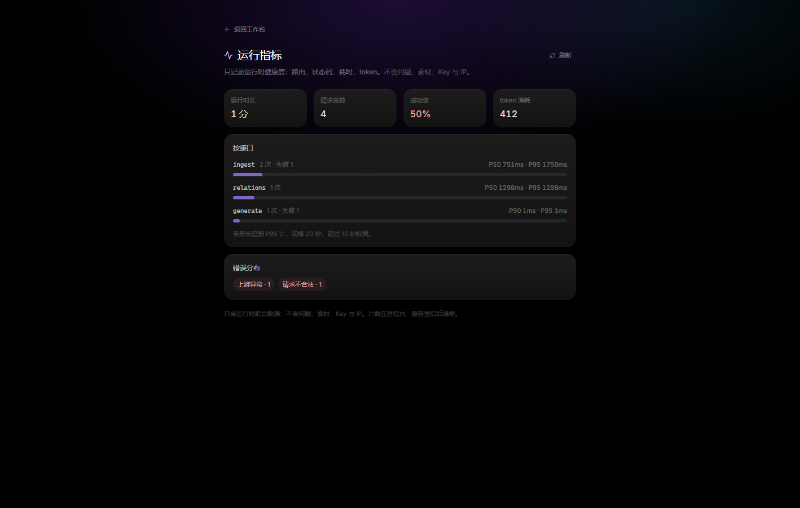

<p align="center"><sub>图 6　运行指标页</sub></p>

### 4.3 架构

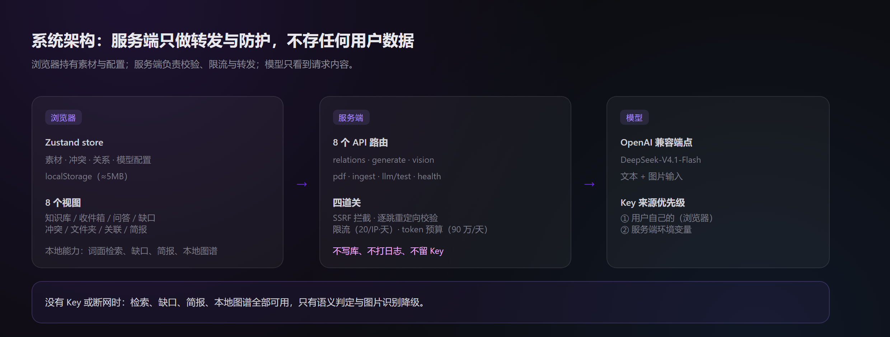

<p align="center"><sub>图 7　系统架构</sub></p>

服务端 9 个接口，只做校验、限流与转发，**不写库、不打日志、不留 Key**。

---

## 五、项目相关的图片 / 照片

| 图 | 说明 |
|---|---|
| 图 8 | 落地页：three.js 着色器实时绘制的星云 |
| 图 9 | 收件箱：未消化素材与「让模型帮我想」 |
| 图 10 | 缺口：覆盖率与缺失方向 |
| 图 11 | 关联图谱：节点、连线与右侧关系列表 |
| 图 12 | 冲突处理链路 |
| 图 13 | 手机端：全屏详情抽屉 |

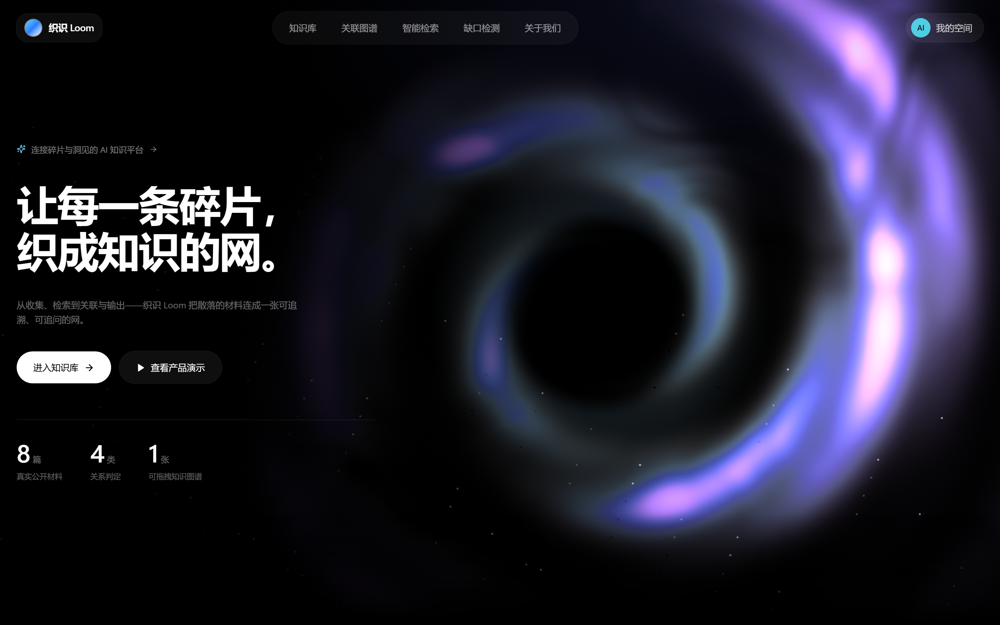

<p align="center"><sub>图 8　落地页</sub></p>

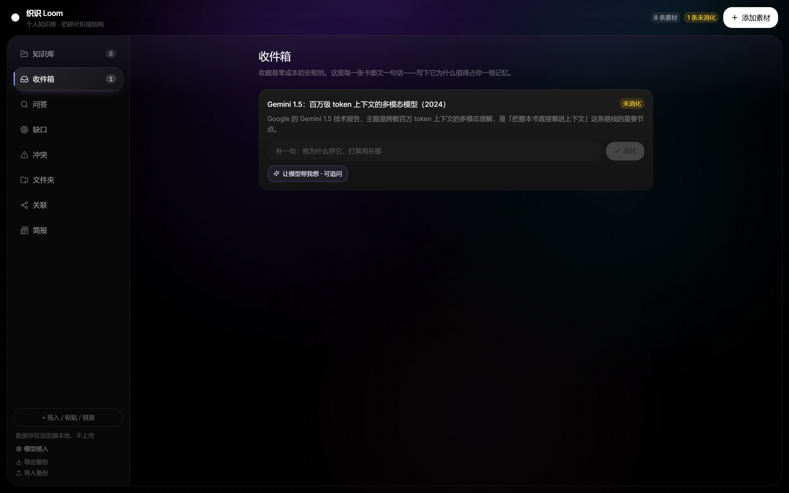

<p align="center"><sub>图 9　收件箱</sub></p>

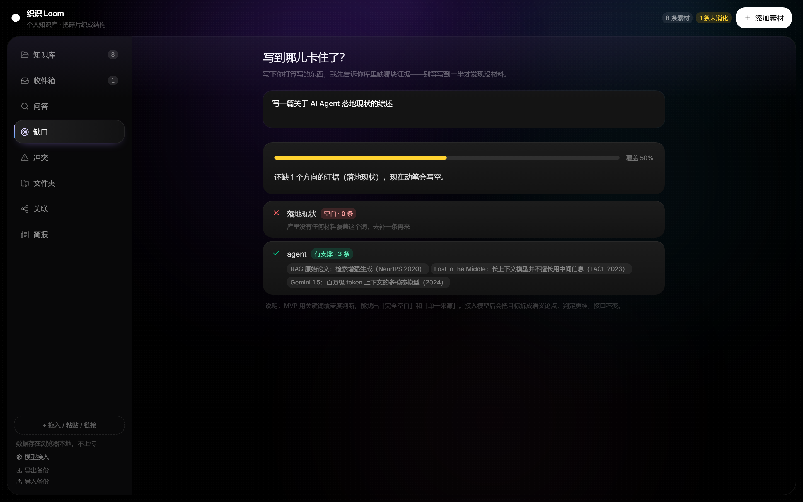

<p align="center"><sub>图 10　缺口检测</sub></p>

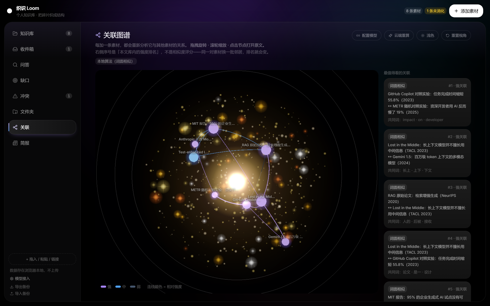

<p align="center"><sub>图 11　关联图谱</sub></p>

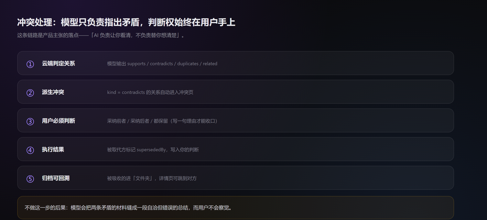

<p align="center"><sub>图 12　冲突处理链路</sub></p>

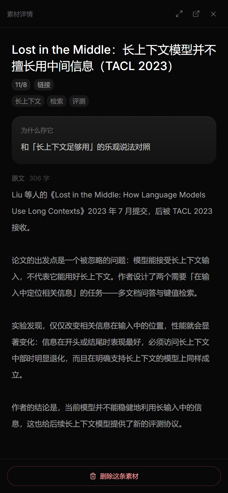

<p align="center"><sub>图 13　手机端详情（390×844）</sub></p>

---

## 六、是否发表过或获奖

本项目为**首次提交**，此前未在公开渠道发表，也未参加过其他赛事或获奖。

视频、文档与线上演示均为本次参赛期间制作。

---

## 七、是否在其他项目基础上优化

本项目为**独立开发**，未基于他人的开源项目或既有产品二次开发。

技术选型上使用了开源库（Next.js、three.js、pdfjs-dist、Zustand 等），均为通用基础设施，不涉及业务代码复用。所有业务逻辑——检索、缺口、冲突派生、图谱布局、提示词——均为本作品自行实现。

内置的 8 条示例素材为**真实公开材料**（Fortune / Anthropic / arXiv / APS 等），仅作为演示数据，不涉及代码复用。
