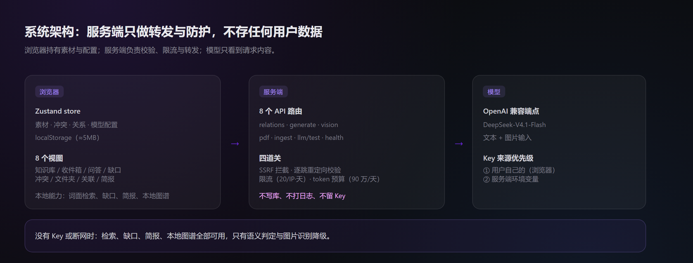
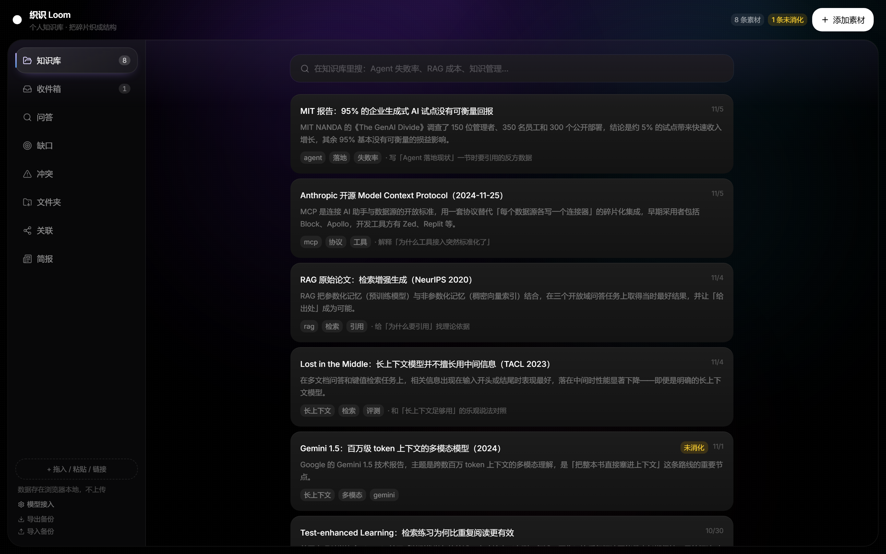
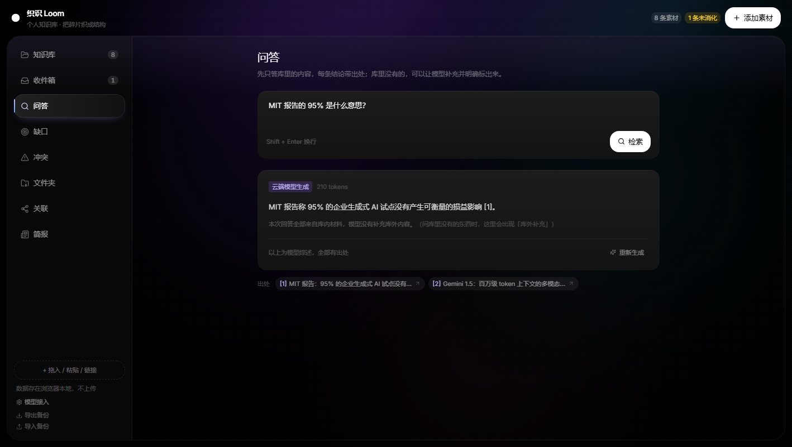
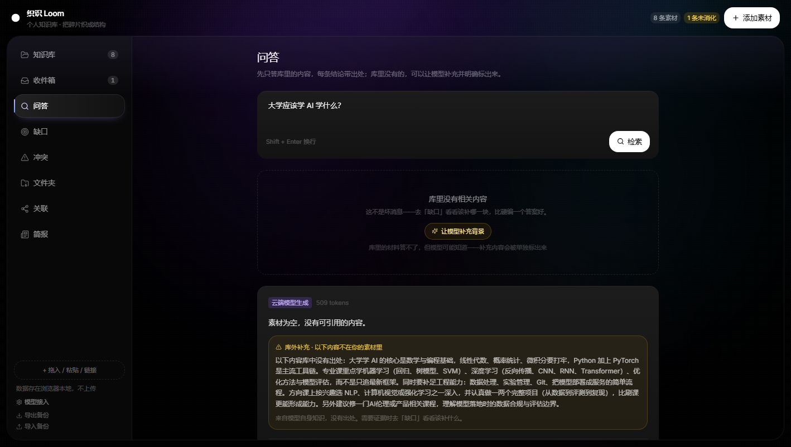
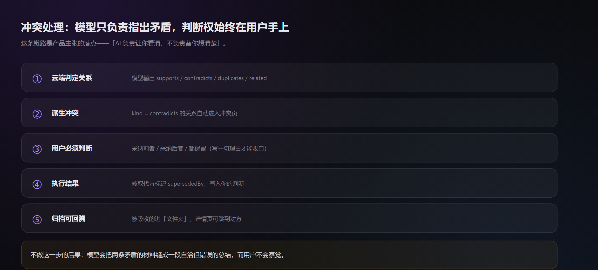
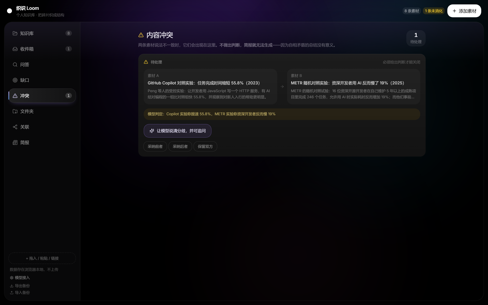
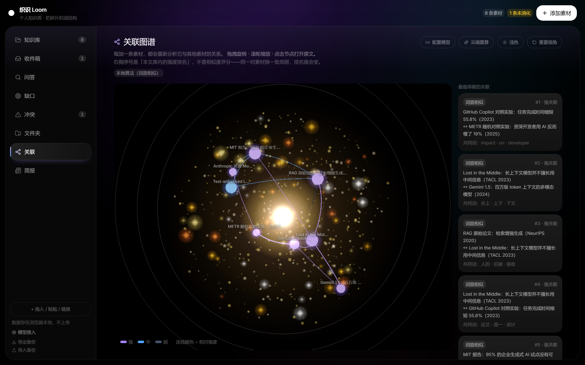
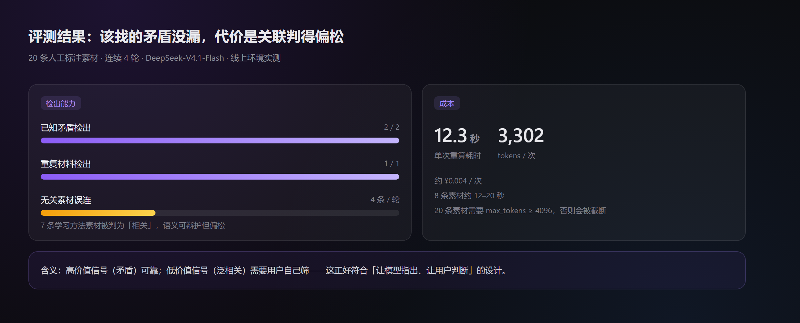
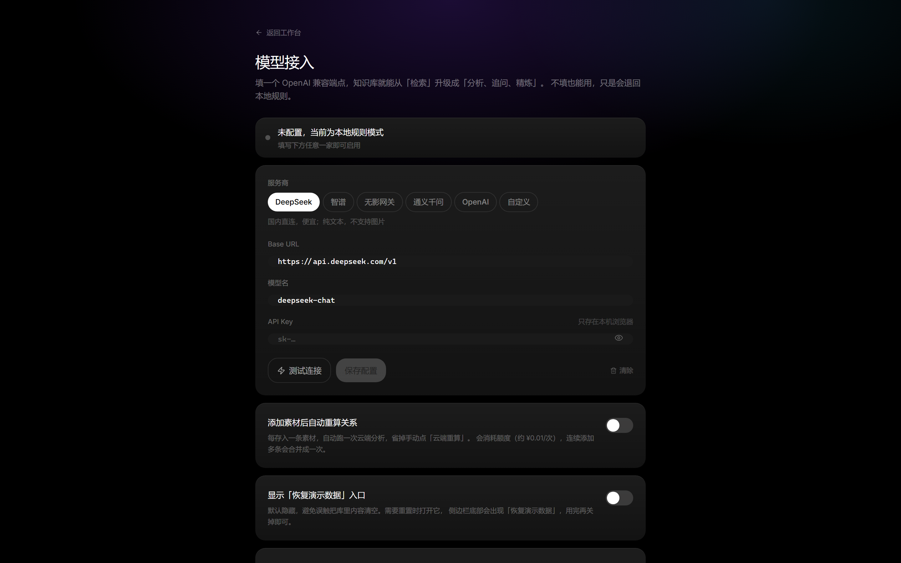

# 织识 Loom · 技术报告

> 个人知识库助手 · 传智杯 AI Web 开发挑战赛
> 线上演示：http://8.163.104.134
> 仓库：https://github.com/Andre-lingfeng/loom

---

## 目录

1. [问题](#1-问题)
2. [设计取舍](#2-设计取舍)
3. [系统架构](#3-系统架构)
4. [关键实现](#4-关键实现)
5. [评测](#5-评测)
6. [局限与后续](#6-局限与后续)
7. [附录](#7-附录)

---

## 1. 问题

### 1.1 起点：一个自己的习惯

这个作品不是从「想做个 AI 应用」开始的。

> 在短视频软件里，我收藏了很多自己认为有用的视频。但这些视频进了收藏夹之后就再没打开过，有些甚至没完整看完。后来我开始留意到这种情况，会不定期打开「我的收藏」，但收效甚微。

这里的失败不在「找不到」，而在**收藏这个动作本身提供了「我已经获得了」的错觉**。收藏越方便，这种错觉越强。

复述一遍行为链：看到 → 觉得有用 → 收藏 → **获得心理上的完成感** → 不再打开。问题出在第四步——收藏替代了学习，而不是通往学习。

竞赛只是这个作品的引线。困扰在这之前就有了，作品是顺着它长出来的。

### 1.2 现象抽象

知识管理工具解决的是「存」，但存完之后的学习过程没人管。

三个可观察的失败模式：

| 失败模式 | 表现 | 现有工具的对策 |
|---|---|---|
| **存了不看** | 收藏夹里 300 条，一条没重读过 | 无（甚至用「一键剪藏」加速囤积） |
| **看了不写** | 读完觉得懂了，合上就忘 | 无 |
| **写了不判断** | 素材之间互相矛盾，笔记却拼成一段自洽的结论 | 无 |

第三条最危险：模型会把两条冲突的材料缝合成一段流畅但错误的总结，而用户不会察觉。

### 1.3 主张

> **AI 负责让你看清，不负责替你想清楚。**

产品把「输出」变成流程的一部分，而不是可选动作：

- 存素材必须写一句「为什么存它」，否则进收件箱挂着
- 写作前先查缺口，指出哪些论点没有证据
- 素材之间矛盾时，模型标出来，但**必须由用户做出判断**才能收口

### 1.4 目标用户

自己写东西的人：学生、研究者、写作者、产品经理。共同点是「需要把读到的材料变成自己的判断」。

反过来，不用写东西、只是收集资料的人不需要这个工具——他们需要的是搜索，不是判断。

---

## 2. 设计取舍

> 这一节是全文最该体现"为什么"的地方。每条决策都应写成「候选方案 → 选择 → 理由 → 代价」。

### 2.1 不做账号体系

账号体系一开始是**计划要做的**，后来主动砍掉。两个原因：

1. **时间与安全**。短时间做出来的账号体系，安全性无法保证。而在"有一个能用的账号"和"用户数据是安全的"之间，后者重要得多。
2. **存储成本**。资金有限，服务器配置很低，没有余力搭数据库。

| 方案 | 选择 | 理由 | 代价 |
|---|---|---|---|
| 账号 + 云端数据库 | ❌ | 短周期内无法保证数据安全；服务器资源不足 | 换设备数据不迁移 |
| **纯浏览器存储** | ✅ | 数据不出浏览器，不存在"托管用户数据"的责任 | 受 localStorage 5MB 限制；清缓存即丢（已提供导出备份） |

> 这不是"偷懒省事"，而是把风险明确地留在自己可控的范围内：宁可牺牲同步能力，也不做半吊子的数据托管。

### 2.2 不做向量检索

考虑过，评估后放弃。拦路的不是"难写"，而是四件工程代价：

| 成本项 | 具体问题 |
|---|---|
| 存储与计算 | 高维向量的存储和相似度计算开销高于当前规模所需 |
| 嵌入质量 | 检索效果几乎完全由嵌入模型决定，选型失败则整套方案失效 |
| 元数据过滤 | 需要按时间、来源、标签过滤，向量库的过滤能力参差 |
| 增量更新 | 新增/删除素材要维护索引一致性，还要处理多租户隔离 |

| 方案 | 选择 | 理由 | 代价 |
|---|---|---|---|
| 向量库 + 嵌入模型 | ❌ | 上述四项成本与当前素材规模不匹配 | —— |
| **词面打分 + 云端模型判语义** | ✅ | 检索可离线、零成本、结果可解释；语义判断交给模型 | 同义改写可能召回不到 |

放弃向量检索之后，语义召回由云端模型承担。这个替代在当时看是划算的：

| 维度 | 向量检索 | 云端模型替代 |
|---|---|---|
| 实现成本 | 需索引、嵌入、增量更新 | 一次 API 调用 |
| 效果来源 | 嵌入模型质量决定上限 | 大模型本身的语言理解 |
| 运行成本 | 存储 + 计算常驻 | 按次计费，闲时为零 |
| 依赖 | 无网络要求 | **必须有 Key、必须联网** |

> 作者当时的判断原话：向量检索难度大，于是考虑用云端模型替代；替代之后，云端效果相比向量检索还有一些优势。

代价在 2.5 里交代：一旦没有 Key 或断网，语义能力就退回词面匹配。

**这个决定直接引出了 2.4**：既然不靠向量做语义召回，模型的判断就不能被"检索不到"卡死，于是允许它在标注清楚的前提下补充库外知识。

### 2.3 冲突必须由用户判断

模型只输出「这两条矛盾，争的是 X」，**不给结论**。用户必须选一边或选「都保留」，并写一句判断。

> 理由（作者原话）：学习效果来自持续的反馈，而不仅仅是内容堆砌。让用户自己处理冲突，一是让他知道自己的知识库里存在矛盾观点，二是让他自行决定取舍——这比模型自动处理更贴近他真实的想法。

换句话说：模型替用户决定，产品就退化成"总结器"，用户失去判断力的训练。

代价：多一步操作，流程更重。这是**刻意的摩擦**。

### 2.4 允许库外知识，但必须分区

初版只能答库内内容，导致「库里有相关内容但检索不到」时直接失效。现改为两段式：

```
【库中依据】  只用素材，每句带 [1][2]
【库外补充】  模型自身知识，前端用琥珀色块单独呈现
```

> 理由：拒绝回答会毁掉可用性；混在一起会毁掉可信度。分区是唯一同时保住两者的做法。

### 2.5 云端全部可降级

没有 Key、断网时，检索、缺口、简报、图谱（本地算法）全部可用。

> 理由：很多 AI 作品断网即白屏。可降级意味着产品的核心价值不完全依赖外部服务。

---

## 3. 系统架构

### 3.1 技术栈

| 层 | 选型 |
|---|---|
| 框架 | Next.js 15.5（App Router）+ React 19 |
| 语言 | TypeScript（strict） |
| 样式 | Tailwind v4（CSS-first）+ 设计令牌 |
| 状态 | Zustand（含 localStorage 持久化） |
| 3D | three.js 0.186 |
| PDF | pdfjs-dist（浏览器端）+ unpdf（服务端兜底） |
| 部署 | 阿里云轻量服务器 · pm2 · Node 22 |

### 3.2 结构

```
app/
  page.tsx                落地页（Server Component）
  kb/page.tsx             知识库工作台
  kb/settings/page.tsx    模型接入
  api/                    8 个接口
components/kb/            8 个视图 + 弹窗 + 抽屉 + 图谱
lib/kb/                   领域逻辑（检索、图谱、冲突、生成、备份）
lib/server/               服务端：模型解析、SSRF 防护、错误翻译
```

### 3.3 数据流

```
用户操作
   ↓
Zustand store ──localStorage──→ 素材 / 冲突 / 关系 / 配置
   ↓ 需要云端时
fetch /api/*  ──→ 服务端校验（SSRF / 限流 / token 预算）
                     ↓
                 转发给 OpenAI 兼容端点（用户 Key 优先，其次服务端 Key）
                     ↓
                 结果回到 store，落 localStorage
```

关键点：**服务端不存任何用户数据**，只做转发与防护。


<p align="center"><sub>图 1　系统架构：浏览器持有数据，服务端只做转发与防护</sub></p>




<p align="center"><sub>图 2　知识库主视图：搜索、清单、标签与「为什么存它」</sub></p>

### 3.4 八个接口

| 接口 | 作用 | 防护 |
|---|---|---|
| `/api/relations` | 判定素材间关系 | 限流 + token 记账 + JSON 容错 |
| `/api/generate` | 简报 / 问答 / 意图 / 冲突分析 | 同左 |
| `/api/vision` | 图片转文字 | 图片头校验 + 体积上限 |
| `/api/vision/test` | 视觉能力测试（真发图） | 30s 超时 |
| `/api/pdf` | PDF 解析（服务端兜底） | 体积/页数上限 + 抓取限额 |
| `/api/ingest` | 网页正文抓取 | **SSRF 防护** + 逐跳重定向校验 + 2MB 上限 |
| `/api/llm/test` | 连接测试 + 列出可用模型 | 15s 超时 |
| `/api/health` | 部署体检 + 额度查询 | 不返回任何密钥内容 |

---

## 4. 关键实现

### 4.1 本地检索与引用

`lib/kb/answer.ts`：分词 → 覆盖度打分 → 取前 N 条 → 拼原文片段。

- 相关性阈值：`hits >= 2 && score >= top * 0.45`，避免微弱命中污染结果
- 已确认分歧的素材对被同时拉入，保证冲突不被"检索漏掉"
- 引用编号与展示编号严格对齐（模型标注的 `[1]` 不会指错）


![图 3　问答的两段式输出：上半部分每个结论带 [1][2] 出处，下半部分是独立的「库外补充」](report/06-ask-cloud.png)

<p align="center"><sub>图 3　问答的两段式输出：上半部分每个结论带 [1][2] 出处，下半部分是独立的「库外补充」</sub></p>



<p align="center"><sub>图 3b　材料足够时，界面明确说明「没有补充库外内容」，避免被误认为功能缺失</sub></p>



<p align="center"><sub>图 3c　库里完全没有相关内容时：仍可让模型补充背景，结果全部标为「库外补充」</sub></p>

### 4.2 关系判定的容错

模型输出不可控，做了四层容错：

1. **去代码围栏** + 按括号深度截取最外层 JSON
2. **字段别名**：`a|source|from`、`b|target|to`
3. **kind 归一**：`contradiction/conflict → contradicts`
4. **失败重试一次**，追加更严格的指令

> 若不处理，模型返回 `source/target` 时会被静默丢弃，接口返回 200 但关系为 0——用户以为"模型觉得没关系"。

### 4.3 冲突的派生与可逆

冲突不是预置数据，而是从 `kind === "contradicts"` 的关系**派生**出来的。

- 判断必须填写 note 才能关闭
- `resolveConflict` 完全可逆：改判时先清除双方的 `supersededBy / absorbedBy / disputesWith`，再应用新选择
- 被吸收的素材进「文件夹」，详情页可交叉跳转到对方




<p align="center"><sub>图 4　冲突处理链路：模型只指出矛盾，判断由用户完成</sub></p>



<p align="center"><sub>图 5　冲突页：必须给出判断才能收口，可选「让模型说清分歧，并可追问」</sub></p>

### 4.4 3D 图谱的性能

| 手段 | 效果 |
|---|---|
| DPR 上限 1.25 | 2 倍屏像素少 44% |
| 30fps 上限 + 离屏暂停 | 静止时几乎零开销 |
| **泛光默认关闭**，测 8 帧渲染耗时 < 7ms 才开 | 弱卡不拖垮 |
| 粒子 900→520，耀斑 110→70 | 绘制调用减少 |
| 渲染耗时 > 16ms 自动降级（关泛光 + DPR 0.85） | 兜底 |

> 关键教训：用 **rAF 间隔**判断"慢"是错的——限帧 30 后间隔恒为 33ms，会误判。必须测渲染耗时。




<p align="center"><sub>图 6　关联图谱：节点大小表示关联度，右侧列出最值得看的关联</sub></p>

### 4.5 PDF：浏览器内解析

`pdfjs-dist` 在前端解析，文件不上传，因此**没有 4MB 限制**。

- worker 由 `postinstall` + `prebuild` 复制到 `public/`
- 300 页 / 7.2MB 的 PDF 实测解析出 127 万字，全程零网络请求
- 超过 4 万字自动截断（localStorage 容量所限），并在界面上明确提示
- 扫描件无文字层时提示改用图片入口

### 4.6 图片：阶梯压缩

```
[1280, 0.80] → [1100, 0.75] → [960, 0.70] → [800, 0.65] → [640, 0.60]
目标：base64 ≤ 1.2M，达标即停
```

实测 6.6MB / 3600×2400 的 PNG，压缩后发给模型的 JSON 仅 112KB。

### 4.7 安全

| 风险 | 处理 |
|---|---|
| **SSRF**（`/api/ingest` 抓任意 URL） | 私网/回环/元数据地址拦截；DNS 解析后再校验；重定向逐跳校验；响应体 2MB 上限 |
| 配额耗尽导致账单失控 | 每 IP 20 次/天 + 全站 300 次/天 + **token 预算 90 万/天** |
| 配额计数跨路由失效 | 计数挂 `globalThis`（Next 各路由是独立模块） |
| Key 泄露 | 只存浏览器或服务端环境变量；不落库、不打日志、不进仓库 |

---

## 5. 评测

> 所有数字均为线上环境（http://8.163.104.134）实测，DeepSeek-V4.1-Flash，2025-11。

### 5.1 功能验证

| 项 | 方法 | 结果 |
|---|---|---|
| 设计规则 | `pnpm audit:ui`（8 条） | 8/8 |
| 单元测试 | `node --test` | 6/6 |
| 端到端 | `pnpm test:e2e`（真实 Chrome） | 4/4 |
| 视觉识别 | 296KB 界面截图 | 完整读出结构与文字 |
| PDF 解析 | 7.2MB / 300 页 | 127 万字，零上传 |

### 5.2 关系判定质量

**方法**：人工设计 20 条素材并标注真值，其中

- 2 对已知矛盾（Copilot 55.8% vs METR −19%；长上下文够用论 vs Lost in the Middle）
- 1 对重复（同一份 MIT 报告的两种表述）
- 2 对支持关系
- 7 条互不相关的学习方法素材（用于测误连）

每轮把 20 条一次性交给模型，连续跑 4 轮。

| 指标 | 结果 | 说明 |
|---|---|---|
| **矛盾召回** | **2 / 2** | 4 轮全部命中，无遗漏 |
| **重复召回** | **1 / 1** | 同上 |
| 矛盾误报 | 0.3 条/轮 | 偶发把「RAG 优于纯参数模型」与「全文入上下文替代 RAG」判为矛盾，可辩护 |
| 无关素材误连 | 4.0 条/轮 | 7 条学习方法之间被判为 related，语义上可辩护但偏松 |
| 平均关系数 | 13.0 条 | 20 条素材，约 1.3 条/素材 |
| 平均耗时 | **12.3 秒** | 含网络与推理 |
| 平均 token | **3,302** | 单次重算成本约 ¥0.004 |

**过程中发现并修复的问题**：初版 `max_tokens = 2200`，20 条素材时有 1/3 的请求被截断，返回「输出被长度限制截断」。提高到 4096 后 4/4 成功。




<p align="center"><sub>图 7　关系判定评测结果：矛盾与重复 100% 检出，噪声来自泛相关</sub></p>
**结论**：模型在**该找的矛盾上没漏**（召回 100%），代价是**关联判得偏松**——把同属"主动学习"的七条方法互相连了起来。对产品的含义是：高价值信号（矛盾）可靠，低价值信号（泛相关）需要用户自己筛。

### 5.3 问答质量

**方法**：4 个问题覆盖三类场景，逐条人工判定。判据：是否带引用编号、是否区分"库中依据/库外补充"、是否编造。

| 用例 | 场景 | 引用 | 两段结构 | 人工判定 |
|---|---|---|---|---|
| A | 库内可答（矛盾对比） | ✅ [1][2] | ✅ | **通过**：分别陈述两实验，并指出条件不同 |
| B | 库内可答（单材料） | ✅ [1] | ✅ | **通过**：未编造论文外数据 |
| C | **库内不可答**（注意力复杂度） | ✅ | ✅ | **通过**：明确说「素材中没有相关内容」，复杂度只出现在库外补充 |
| D | 跨材料综合（能否替代 RAG） | ✅ [1][2][3] | ✅ | **通过**：分述两种立场与成本，未合并成单一结论 |
| E | 库内完全无结果（大学学 AI 学什么） | 无（无素材） | ✅ | **通过**：明确说「素材为空」，全部内容进入库外补充 |

| 指标 | 结果 |
|---|---|
| 引用标注率 | 4 / 4 |
| 两段结构合规率 | 4 / 4 |
| 编造数据 | 0 例 |
| 平均耗时 | **3.3 秒**（2.6–4.4s） |
| 平均 token | **668**（527–913） |

**C 用例最能说明设计意图**：模型没有硬凑答案，而是先说"这两条素材都是 AI 编程工具实验，无法回答"，再把复杂度知识放进库外补充。

### 5.4 性能

测试条件：Chrome 移动端 390×844，**4G 网络（9Mbps / RTT 85ms）+ 4 倍 CPU 降速**。

| 页面 | LCP | DOMContentLoaded | load |
|---|---|---|---|
| 落地页 `/` | **2,628ms** | 2,873ms | 2,874ms |
| 工作台 `/kb` | **1,276ms** | 332ms | 334ms |

其他指标：

| 项 | 结果 |
|---|---|
| 图谱帧率 | 桌面端稳定在 30fps 上限内（主动限帧） |
| 移动端横向溢出 | 0px（8 个视图全部通过） |
| 云端重算（8 条素材） | 12–20 秒 |
| 图片压缩 | 6.6MB PNG → 112KB 请求体 |

> 落地页 LCP 偏高，主要来自 3D 星云首次编译着色器；已做 DPR 上限、30fps 限帧与离屏暂停，但在 4 倍 CPU 降速下仍有 2.6 秒。工作台页面因为没有 3D 首屏，LCP 仅 1.3 秒。

### 5.5 评测本身的局限

这些数字能说明"能用"，但**不足以说明"可靠"**，原因有三：

1. **规模小**：20 条素材，无法代表上百条的真实知识库（关系数随规模超线性增长）
2. **真值单人标注**：是否算"矛盾"本身有判断空间，换个人标可能得到不同数字
3. **只测了一个模型**：DeepSeek-V4.1-Flash，换模型结论可能完全不同

如果要让它更像实验，至少还要补：多名标注者、更大的素材集、跨模型对比。

## 6. 局限与后续

### 6.1 已知局限

1. **数据只在单台浏览器**：换设备不迁移，清缓存即丢（可导出 JSON 备份）
2. **localStorage 约 5MB**：单条正文入库上限 4 万字
3. **无账号体系**：无法分享、协作
4. **冲突判定依赖模型**：模型判错时用户只能改判，不能校正模型
5. **无 HTTPS**：当前 HTTP 访问，演示够用
6. **评测规模有限**：20 条素材、单人标注真值、仅测一个模型（详见 5.5）

### 6.2 如果再多两周

会先补账号体系——但这**不推翻 2.1 的决定**，而是承认那是"时间与资源受限下的取舍"：

| 约束 | 当时的情况 | 有两周的情况 |
|---|---|---|
| 时间 | 安全做不完 | 够做实名 + 会话 + 加密存储 |
| 服务器 | 2 核 2G，无余力建库 | 可加一台数据库实例 |
| 结论 | 宁可不做，也不做半吊子 | 可以做完整版本 |

顺序会是：**账号 → 加密存储 → 端到端同步 → 冲突合并策略**。最后一步最难，因为要处理"两台设备同时改同一条素材"。

### 6.3 最不放心的地方：会不会没人用

技术上最不放心的是数据只在本地；但**真正的不安全感来自需求本身**——这个产品解决的是「收藏了不看」，而这件事的痛点强度，只有真实用户能验证。

目前支撑它的证据只有三条：

1. 作者自己的短视频收藏夹（第 1 节）
2. 身边同学的类似反馈
3. 20 条素材上的功能验证

这三条都不足以证明"有人愿意为此改变行为"。**一个逼用户输出的工具，最大的风险是用户嫌麻烦**。

这也是下一步最该做的事：**找 5 个真实用户用两周，看他们第 8 天还会不会打开**。如果不会，功能做得再多也没有意义。

### 6.4 从"作品"到"产品"还差什么

- 账号与数据同步（能力问题）
- 真实用户的使用数据（验证问题，比能力更关键）
- 关系判定的持续评测与提示词迭代（质量问题）

---

## 7. 附录

### 7.1 复现

```bash
pnpm install
pnpm dev            # 开发
pnpm demo           # 构建 + 启动
pnpm verify         # 设计规则 + 类型 + 单测
pnpm test:e2e       # 浏览器冒烟（需先启动服务）
```

### 7.2 部署

见 `docs/DEPLOY.md`（Vercel）与 `deploy/README.md`（自建服务器）、`deploy/aliyun.md`（阿里云）。

### 7.3 数据来源

内置 8 条素材均为**真实公开材料**，标题、日期、链接可核对。其中两条（GitHub Copilot 对照实验 / METR 随机对照实验）是**刻意选的矛盾证据**，用于演示冲突检测。




<p align="center"><sub>图 8　模型接入页：主模型与视觉模型可分别配置，也可只填一个</sub></p>

### 7.4 第三方依赖

| 依赖 | 用途 | 许可 |
|---|---|---|
| next / react | 框架 | MIT |
| three | 3D 图谱 | MIT |
| pdfjs-dist | PDF 解析 | Apache-2.0 |
| unpdf | 服务端 PDF 兜底 | MIT |
| lucide-react | 图标 | ISC |
| zustand | 状态 | MIT |
